(.venv) PS D:\Next-Gen Coding 2026\Reto M2\m2-api-base> pytest -q                      
......                                                                                                                                                                               [100%]
(.venv) PS D:\Next-Gen Coding 2026\Reto M2\m2-api-base> ruff check
All checks passed!

(.venv) PS D:\Next-Gen Coding 2026\Reto M2\m2-api-base> pytest --cov=users.routes --cov-report=term-missing    
......                                                                               [100%]
===================================== tests coverage ======================================
_____________________ coverage: platform win32, python 3.14.8-final-0 _____________________

Name              Stmts   Miss  Cover   Missing
-----------------------------------------------
users\routes.py      13      0   100%
-----------------------------------------------
TOTAL                13      0   100%
6 passed in 0.21s                     

# Evidencia — Reto M2
## 1. Especificación y contexto

Objetivo: que el equipo registre y consulte sus tareas operativas, para que no se pierda trabajo sin registrar (es el objetivo del sprint).
Alcance: crear y consultar tareas. Fuera de alcance: editar, borrar, listar y usuarios asignados.

Criterios de aceptación 

## 2. Generación de código (prompts, qué acepté y qué rechacé)
### Prompt
❯ Lee @CLAUDE.md, @users/routes.py, @users/service.py, @users/repository.py,
  @users/schemas.py, @core/errors.py y @tests/test_users.py.
  Resúmeme en 5 líneas las convenciones del proyecto y qué archivos usarías como
  ejemplo para añadir un endpoint nuevo al recurso users. No cambies nada.

### Respuesta
Convenciones (5 líneas):

1. Cada recurso tiene cuatro capas: routes.py → service.py → repository.py, más schemas.py. La ruta solo delega en el service, y solo el service habla con el repositorio.
2. Las rutas siempre declaran response_model= y devuelven modelos Pydantic, nunca dict. Los modelos de entrada terminan en *Create/*Update.
3. Los errores se levantan solo en el service, con core/errors.py (not_found, invalid_request, already_exists). Nunca se usa HTTPException a mano.
4. Los identificadores van en inglés y snake_case, sin abreviaturas. Los mensajes de error y los nombres de los tests van en español. Las rutas específicas (/users/search) se declaran antes que las que llevan parámetro (/users/{user_id}).
5. Cada endpoint nuevo lleva sus tests en tests/test_users.py: al menos un caso feliz y uno de error, uno por caso, con arrange/act/assert separados. No se tocan migrations/ ni legacy/.

Archivos que se usarían como ejemplo para un endpoint nuevo en users:

- users/routes.py:22-24 (get_user) es el modelo de ruta con parámetro y response_model. :27-29 (create_user) sirve para un POST con
  status_code.
- users/service.py:12-16 (get_user) muestra la búsqueda más la decisión de error con errors.not_found. :23-26 muestra una validación de
  negocio con already_exists.
- users/repository.py:43-45 (find_by_email) es la plantilla para una consulta nueva sobre el dict.
- users/schemas.py sirve si el endpoint necesita un mod.
- tests/test_users.py:18-29 es la pareja de test feliz (200) y de error (404) que hay que replicar.
- CLAUDE.md también tiene una sección sobre un recurso tasks (reto M2) con reglas extra: docstrings estilo Google, la fecha "hoy" inyectada como dependencia, idempotencia y cobertura >90%. Esas reglas aplican a tasks/, no a users/. No he modificado nada.

### Esqueleto
### Prompt
Quiero crear el recurso tasks con POST /tasks y GET /tasks/{task_id}, según
@docs/spec-task.md, siguiendo el patrón de @users/ y las convenciones de @CLAUDE.md.
Dame solo el ESQUELETO: la carpeta tasks/ con routes.py, service.py, schemas.py y
repository.py (firmas y tipos), y el registro del router en @main.py.
Pon un TODO donde irían la validación de fecha pasada, la idempotencia y el caso
"no encontrado". NO implementes lógica todavía.
Dime qué código de estado devuelve errors.invalid_request en @core/errors.py.

### Respuesta

El esqueleto de tasks/ ya está creado y el router está registrado en main.py. Sin ninguna lógica implementada, ruff check . pasa limpio y los 6 tests existentes siguen en verde. Los endpoints responden 500 por ahora: todo cuerpo pendiente lanza NotImplementedError.

El archivo se llama docs/spec-tasks.md, no spec-task.md. Usé ese.

Qué contiene cada archivo:
- tasks/schemas.py:
  - TaskCreate lleva title (3–100 caracteres), priority (1–5) y due_date: date. Los límites de largo y rango ya están declarados con Field, como pide CLAUDE.md.
  - TaskOut lleva id, title, priority, due_date y status: Literal["pending"].
  - Dejé un TODO extra: rechazar títulos que sean solo espacios. La spec lo pide en CA2 y Field no lo cubre.
- tasks/repository.py: un dict de tareas y otro de clavunciones están solo con firma: add, get,

### Verificación

| Campo      | Qué es             | Regla                                                  |
|------------|--------------------|--------------------------------------------------------|
| `title`    | Nombre de la tarea | Obligatorio, de 3 a 100 caracteres, no solo espacios   |
| `priority` | Urgencia           | Entero del 1 (baja) al 5 (alta)                        |
| `due_date` | Fecha límite       | Formato `AAAA-MM-DD`; hoy o una fecha futura           |

Los 4 archivos creados están en tasks/ y no se tocó users/.	
En main.py se agregó app.include_router(tasks_routes.router).
Las dos rutas incluyen: response_model=TaskOut.
Las dos rutas solo llaman a service.create_task y service.get_task. 
El POST devuelve 201: status_code=status.HTTP_201_CREATED.
Todas las funciones creadas dicen raise NotImplementedError. Hay dos excepciones aceptables:

En schemas.py ya puso las reglas del título (3 a 100 caracteres) y de la prioridad (1 a 5). Son declaraciones de una línea, no lógica compleja, así que las acepté.
En routes.py ya escribió get_today(), que devuelve la fecha de hoy. Es correcto que esté ahí y no en service.py.

pytest -q
[100%]
(.venv) PS D:\Next-Gen Coding 2026\Reto M2\m2-api-base> ruff check
All checks passed!

### Implementación incremental - Prompt 
implementa solo el happy path de @tasks/: repository.add, get y reset;
service.create_task crea la tarea con status "pending" y service.get_task la devuelve.
Sin validar fecha pasada, sin idempotencia y sin manejar "no encontrado" todavía.
Corre `pytest -q`.

### Respuesta
El happy path de tasks/ ya funciona. pytest -q pasa los 6 tests, pero todos son de users: tasks todavía no tiene ninguno. ruff check . pasa limpio.

Qué implementé:
- repository.add crea la tarea con id incremental y status="pending" y la guarda en el dict.
- repository.get devuelve la tarea o None.
- repository.reset vacía las tareas y las claves de idempotencia y reinicia el id a 1.
- service.create_task llama a repository.add y service.get_task a repository.get. Los TODO de fecha pasada, idempotencia y no encontrado siguen en su lugar.

Prueba a mano: hice una llamada fuera de pytest con el ejemplo de la spec:
- POST /tasks devolvió 201 con {"id": 1, "title": "Revisar respaldo nocturno", "priority": 4, "due_date": "2026-11-15", "status": "pending"}, igual que CA1.
- GET /tasks/1 devolvió 200 con esa misma tarea.

Pendiente para los siguientes pasos:
- Id inexistente: GET /tasks/999 hoy responde 500, no 404. get_task devuelve None y FastAPI no puede convertirlo en TaskOut. Se corrige al implementar el TODO de "no encontrado".
- Reset entre tests: tests/conftest.py solo reinicia el repositorio de users. Cuando escribamos tests/test_tasks.py habrá que llamar también a tasks.repository.reset(), o los ids se arrastrarán de un test a otro.

### Aceptar cambios 
git add -A && git commit -m "feat(tasks): crear y consultar tarea, happy path"

### Validaciones -> 422 (CA4 y CA2)

Rechaza títulos de solo espacios en @tasks/schemas.py y, en @tasks/service.py,
si due_date es anterior a today responde 422 con errors.invalid_request de
@core/errors.py (hoy sí se acepta). Confirma qué código devuelve invalid_request.
Corre `pytest -q`.

### Respuesta
GET /tasks/{task_id} ahora responde 404 cuando la tarea no existe. En service.get_task, si repository.get devuelve None, se levanta errors.not_found("tarea", task_id); quité ese TODO y agregué from core import errors. pytest -q pasa los 6 tests y ruff check . pasa limpio.

Lo probé a mano fuera de pytest: GET /tasks/999 devuelve 404 con {"detail": "tarea no encontrado: 999"}, y una tarea recién creada sigue devolviendo 200.

El mensaje tiene un error de concordancia: dice "tarea no encontrado". La plantilla de core/errors.py tiene fijo "no encontrado", que funciona para "usuario" pero no para "tarea". No lo cambié porque ese archivo lo usan todos los recursos. Hay dos formas de arreglarlo:
- Usar otro nombre de recurso: pasar "recurso tarea" en vez de "tarea". Solo cambia tasks/service.py, pero el mensaje queda raro.
- Ajustar core/errors.py: cambiar la plantilla a algo neutro como f"No se encontró {resource}: {identifier}". El mensaje de users cambia, pero su test ("no encontrado" in detail) se tendría que ajustar.

Además, falta lo que pide CLAUDE.md para este endpoint: aún no hay tests de tasks (caso feliz y caso 404) en tests/test_tasks.py.

### Aceptar cambios

git add -A && git commit -m "feat(tasks): validar titulo y fecha pasada"

### No encontrado → 404 (CA6) - Prompt

si la tarea no existe, GET /tasks/{task_id} responde 404 usando
errors.not_found de @core/errors.py, levantado desde service.py. Corre `pytest -q`.

### Respuesta

GET /tasks/{task_id} ahora responde 404 cuando la tarea no existe. En service.get_task, si repository.get devuelve None, se levanta errors.not_found("tarea", task_id); quité ese TODO y agregué from core import errors. pytest -q pasa los 6 tests y ruff check . pasa limpio.

Lo probé a mano fuera de pytest: GET /tasks/999 devuelve 404 con {"detail": "tarea no encontrado: 999"}, y una tarea recién creada sigue devolviendo 200.

El mensaje tiene un error de concordancia: dice "tarea no encontrado". La plantilla de core/errors.py tiene fijo "no encontrado", que funciona para "usuario" pero no para "tarea". No lo cambié porque ese archivo lo usan todos los recursos. Hay dos formas de arreglarlo:
- Usar otro nombre de recurso: pasar "recurso tarea" en vez de "tarea". Solo cambia tasks/service.py, pero el mensaje queda raro.
- Ajustar core/errors.py: cambiar la plantilla a algo neutro como f"No se encontró {resource}: {identifier}". El mensaje de users cambia, pero su test ("no encontrado" in detail) se tendría que ajustar.

Además, falta lo que pide CLAUDE.md para este endpoint: aún no hay tests de tasks (caso feliz y caso 404) en tests/test_tasks.py.

### Idempotencia (CA5)

Si POST /tasks llega con un Idempotency-Key ya usado, devuelve la tarea
original sin crear otra (usa find_by_idempotency_key y save_idempotency_key de
@tasks/repository.py). Corre `pytest -q`.

### Respuesta
POST /tasks ya es idempotente: si llega con un Idempotency-Key ya usado, devuelve la tarea original y no crea otra. pytest -q pasa los 6 tests y ruff check . pasa limpio.

Qué cambié:
- repository.find_by_idempotency_key busca el id asociado a la clave y devuelve esa tarea, o None.
- repository.save_idempotency_key guarda la relación clave → id.
- service.create_task:
  - Si viene una clave ya registrada, devuelve la tarea original sin crear nada.
  - Si no, crea la tarea y, cuando hay clave, la registra.
  - Sin clave, cada POST crea una tarea nueva.
  - El TODO de fecha pasada sigue en su lugar.

Prueba a mano (fuera de pytest):

┌────────────────────────┬────────────────────────────────┐
│        Petición        │           Resultado            │
├────────────────────────┼────────────────────────────────┤
│ POST con abc-123       │ 201, id 1                      │
├────────────────────────┼────────────────────────────────┤
│ Mismo POST con abc-123 │ 201, id 1 (no se duplicó)      │
├────────────────────────┼────────────────────────────────┤
│ POST sin clave         │ 201, id 2                      │
├────────────────────────┼────────────────────────────────┤
│ GET /tasks/3           │ 404 (no hay una tercera tarea) │
└────────────────────────┴────────────────────────────────┘

Decisiones que tomé y puedes cambiar:
- Código del reenvío: responde 201, igual que la primera vez. La spec solo pide devolver la tarea original; si prefieres 200, hay que mover el código de estado de la ruta al service.
- Cuerpo distinto con la misma clave: devuelve la tarea original sin comparar el cuerpo. CA5 habla de "mismo envío", y la otra opción sería responder 409 con already_exists.
- Orden de las comprobaciones: la clave se revisa antes que la fecha. Un reenvío devolverá la original aunque su fecha ya haya pasado.

Todavía no hay tests de tasks. El de idempotencia necesitará el reset de tasks.repository en conftest.py para que el registro de claves no pase de un test a otro.

### Mi revisión

### Las 3 decisiones de Claude

| Decisión | Mi recomendación |
| :--- | :--- |
| El reenvío responde 201 | ✅ **Aceptarla.** Repetir la misma respuesta que la primera vez es lo normal en APIs idempotentes, y es más simple. |
| Cuerpo distinto con la misma clave → devuelve la original | ✅ **Aceptarla**, pero agregarla como limitación conocida en el README. CA5 habla de “mismo envío”, así que cumple. |
| La clave se revisa antes que la fecha | ✅ **Aceptarla**, es correcto. Si alguien reenvía una tarea que ya se creó, debe recibir la original aunque la fecha ya haya pasado. |

### Aceptar cambios

git commit -m "feat(tasks): idempotencia con Idempotency-Key"

### Terminar fecha pasada - prompt

En @tasks/service.py resuelve el TODO de fecha pasada: si due_date es anterior a
today, responde 422 con errors.invalid_request de @core/errors.py y un mensaje en
español (hoy sí se acepta). Respeta el orden actual: la clave de idempotencia se
revisa primero. Dime qué código de estado devuelve invalid_request.
Corre `pytest -q` y `ruff check .`.

### Respuesta

Resolví el TODO de fecha pasada en tasks/service.py. Si due_date es anterior a today, create_task levanta errors.invalid_request con este mensaje:

▎ La fecha límite 2026-10-23 ya pasó; debe ser hoy o una fecha futura.

La comparación es due_date < today, así que la fecha de hoy se acepta. Se comprueba después de la clave de idempotencia, en el orden que pediste.

errors.invalid_request devuelve 422 (HTTP_422_UNPROCESSABLE_CONTENT), en core/errors.py:18-23.

Resultados: pytest -q pasa los 6 tests y ruff check . pasa limpio.

Lo probé a mano fuera de pytest, fijando "hoy" en 2026-10-24 con app.dependency_overrides[get_today]:

┌────────────────────────────────────┬────────────┬──────────────────────────────────────┐
│                Caso                │  due_date  │              Resultado               │
├────────────────────────────────────┼────────────┼──────────────────────────────────────┤
│ Ayer                               │ 2026-10-23 │ 422 con el mensaje de arriba         │
├────────────────────────────────────┼────────────┼──────────────────────────────────────┤
│ Hoy                                │ 2026-10-24 │ 201                                  │
├────────────────────────────────────┼────────────┼──────────────────────────────────────┤
│ Mañana                             │ 2026-10-25 │ 201                                  │
├────────────────────────────────────┼────────────┼──────────────────────────────────────┤
│ Reenvío con clave ya usada, cuerpo │ 2026-10-01 │ 201 con la tarea original, por el    │
│  con fecha pasada                  │            │ orden clave → fecha                  │
└────────────────────────────────────┴────────────┴──────────────────────────────────────┘

Ya no quedan TODO de lógica en el service. Falta el de títulos de solo espacios en schemas.py, y faltan tests/test_tasks.py y el reset de tasks en conftest.py para CA8.

### Aceptar cambios
(.venv) PS D:\Next-Gen Coding 2026\Reto M2\m2-api-base> git commit -m "feat(tasks): 422 cuando la fecha limite ya paso"
[reto-m2-tasks 5318717] feat(tasks): 422 cuando la fecha limite ya paso
 2 files changed, 42 insertions(+), 2 deletions(-)

(.venv) PS D:\Next-Gen Coding 2026\Reto M2\m2-api-base> git commit -m "feat(tasks): 422 cuando la fecha limite ya paso"
[reto-m2-tasks 5318717] feat(tasks): 422 cuando la fecha limite ya paso
 2 files changed, 42 insertions(+), 2 deletions(-)

### Tests

Añade los tests de tasks siguiendo el estilo de @tests/test_users.py y
@docs/spec-task.md:
- En @tests/conftest.py, reinicia también tasks.repository entre tests.
- tests/test_tasks.py: un test por criterio CA1 a CA6, con TestClient,
  estructura Arrange–Act–Assert y nombres descriptivos en español.
  Para la fecha, sobrescribe get_today con una fecha fija (no uses la fecha real).
- Incluye un test de integración: crear una tarea y luego consultarla con GET.
Corre `pytest -q`.

### Respuesta

Los tests de tasks están escritos y pytest -q da 19 pasan, 1 falla. El que falla detecta un hueco real del código: un título de solo espacios ("   ") se acepta con 201 y debería dar 422. Es el TODO que quedó pendiente en tasks/schemas.py: hoy Field(min_length=3) cuenta los 3 espacios como caracteres válidos. No lo corregí porque pediste solo los tests. ruff check . pasa limpio.

tests/conftest.py: el fixture automático ahora reinicia tasks.repository además del de users, antes y después de cada test.

tests/test_tasks.py (14 casos):
- Un fixture automático fija "hoy" en 2026-10-24 con app.dependency_overrides[get_today] y lo quita al terminar. Ningún test usa la fecha real.

┌─────────────┬───────────────────────────────────────────────────────────────────────────────────┬─────────────────────┐
│  Criterio   │                                       Test                                        │    Qué comprueba    │
├─────────────┼───────────────────────────────────────────────────────────────────────────────────┼─────────────────────┤
│ CA1         │ test_create_task_valida_devuelve_201_con_status_pending                           │ 201 y el cuerpo     │
│             │                                                                                   │ completo exacto     │
├─────────────┼───────────────────────────────────────────────────────────────────────────────────┼─────────────────────┤
│             │ test_create_task_titulo_invalido_devuelve_422_y_no_crea_nada (4 variantes: vacío, │ 422, y que GET      │
│ CA2         │  solo espacios, menos de 3, más de 100)                                           │ /tasks/1 da 404 (no │
│             │                                                                                   │  se creó nada)      │
├─────────────┼───────────────────────────────────────────────────────────────────────────────────┼─────────────────────┤
│ CA3         │ test_create_task_prioridad_fuera_de_rango_devuelve_422 (0, 6, "alta")             │ 422 y que no se     │
│             │                                                                                   │ creó nada           │
├─────────────┼───────────────────────────────────────────────────────────────────────────────────┼─────────────────────┤
│ CA4         │ test_create_task_fecha_pasada_devuelve_422_con_mensaje_en_espanol                 │ 422 con el mensaje  │
│             │                                                                                   │ exacto              │
├─────────────┼───────────────────────────────────────────────────────────────────────────────────┼─────────────────────┤
│ CA4         │ test_create_task_fecha_de_hoy_se_acepta                                           │ 201 con la fecha de │
│             │                                                                                   │  hoy                │
├─────────────┼───────────────────────────────────────────────────────────────────────────────────┼─────────────────────┤
│             │                                                                                   │ Cuerpo igual al     │
│ CA5         │ test_create_task_misma_idempotency_key_devuelve_la_original_sin_duplicar          │ original, id 1, y   │
│             │                                                                                   │ GET /tasks/2 da 404 │
├─────────────┼───────────────────────────────────────────────────────────────────────────────────┼─────────────────────┤
│             │ test_get_task_existente_devuelve_200 /                                            │ 200 con la tarea /  │
│ CA6         │ test_get_task_inexistente_devuelve_404_con_mensaje_en_espanol                     │ 404 con el mensaje  │
│             │                                                                                   │ exacto              │
├─────────────┼───────────────────────────────────────────────────────────────────────────────────┼─────────────────────┤
│             │                                                                                   │ El GET devuelve     │
│ Integración │ test_crear_y_consultar_tarea_devuelve_los_mismos_datos                            │ exactamente lo que  │
│             │                                                                                   │ devolvió el POST    │
└─────────────┴───────────────────────────────────────────────────────────────────────────────────┴─────────────────────┘

CA2, CA3 y CA6 tienen varios casos cada uno. Usé parametrize o tests separados para que siga habiendo un caso por test, como en test_users.py.

El test del 404 compara el mensaje exacto "tarea no encontrado: 999". Si después cambias la plantilla de core/errors.py por la concordancia, habrá que actualizarlo.

La spec en docs/ se llama spec-tasks.md, no spec-task.md.

Si quieres, implemento el validador de solo espacios en schemas.py para que pasen los 20.

### Verificamos con pytest -q

(.venv) PS D:\Next-Gen Coding 2026\Reto M2\m2-api-base> pytest tests/test_tasks.py -k "titulo_invalido" -q
.F..                                                                               [100%]
======================================= FAILURES ========================================
______ test_create_task_titulo_invalido_devuelve_422_y_no_crea_nada[solo_espacios] ______

client = <starlette.testclient.TestClient object at 0x0000023243EA11D0>, title = '   '

    @pytest.mark.parametrize(
        "title",
        ["", "   ", "ab", "a" * 101],
        ids=["vacio", "solo_espacios", "menos_de_3", "mas_de_100"],
    )
    def test_create_task_titulo_invalido_devuelve_422_y_no_crea_nada(
        client: TestClient, title: str
    ) -> None:
        payload = {**VALID_PAYLOAD, "title": title}
    
        response = client.post("/tasks", json=payload)
    
>       assert response.status_code == 422
E       assert 201 == 422
E        +  where 201 = <Response [201 Created]>.status_code

tests\test_tasks.py:58: AssertionError
================================ short test summary info ================================
FAILED tests/test_tasks.py::test_create_task_titulo_invalido_devuelve_422_y_no_crea_nada[solo_espacios] - assert 201 == 422

### Debugging con método de clase 3 - Prompt

Este test falla:
test_create_task_titulo_invalido_devuelve_422_y_no_crea_nada, variante "solo espacios".
Qué esperaba: 422 con title "   " (CA2 de @docs/spec-tasks.md).
Qué obtengo: 201, la tarea se crea.
Archivos: @tasks/schemas.py @tests/test_tasks.py

Dame 2-3 hipótesis de la causa, de más a menos probable, y cómo confirmar cada una.
NO cambies código todavía.

### Respuesta

La causa más probable ya está confirmada: TaskCreate acepta "   " porque nada en el schema rechaza títulos de solo espacios. Para comprobarlo corrí solo inspecciones en Python, sin cambiar código.

Hipótesis 1 (la más probable, confirmada): min_length=3 cuenta los espacios como caracteres.
- Field(min_length=3, max_length=100) solo mide el largo de la cadena, y "   " mide exactamente 3. Pydantic no recorta espacios por defecto, y el validador de title es el TODO que quedó en tasks/schemas.py:28.
- Cómo confirmarla: construir el modelo directamente, sin pasar por HTTP: TaskCreate(title="   ", priority=4, due_date="2026-11-15").
- Resultado: se crea sin error, con title == '   ' y len == 3. Las únicas restricciones de title son [MinLen(3), MaxLen(100)]. El fallo está en el schema, no en la ruta ni en el service.

Hipótesis 2 (descartada como causa, pero relacionada): el modelo no tiene configurado el recorte de espacios.
- Con model_config = ConfigDict(str_strip_whitespace=True), Pydantic recortaría "   " a "" antes de aplicar min_length, y daría 422.
- Cómo confirmarla: mirar TaskCreate.model_config.
- Resultado: está vacío ({}), así que no hay recorte. Es el mismo hueco que la hipótesis 1, visto desde la configuración y no desde el campo.

Hipótesis 3 (la menos probable, descartada): la ruta valida con otro modelo o el test no envía lo que parece.
- Pudo ocurrir que POST /tasks usara otro schema, o que el parametrize mandara otro valor.
- Cómo confirmarla: revisar qué modelo valida el cuerpo de la ruta y qué title se guardó.
- Resultado: la ruta usa tasks.schemas.TaskCreate, y el título llega intacto a la hipótesis 1. Las variantes "vacío", "menos de 3" y "más de 100" sí dan 422, lo que también confirma que la ruta valida con TaskCreate.

Cómo arreglarlo, cuando quieras:
- Opción A (recomendada): un field_validator("title") que rechace la cadena si title.strip() queda vacío. Cumple CA2 sin cambiar el contenido de los títulos válidos.
- Opción B: poner str_strip_whitespace=True en model_config. También funciona, pero modifica los títulos válidos: "  Revisar  " se guardaría como "Revisar". Además, " ab " pasaría a dar 422.

### Confirmación de hipótesis # 1

Confirmé la hipótesis número 1 leyendo la línea 24 title: str = Field(min_length=3, max_length=100). Aplica el fix mínimo en @tasks/schemas.py, nada más.
No toques los tests ni otras partes del código. Corre `pytest -q` y `ruff check .`.

### Respuesta

 Read 1 file

● Update(tasks\schemas.py)
Added 23 lines, removed 1 line
    priority: int = Field(ge=1, le=5)
    due_date: date

    # TODO: rechazar títulos de solo espacios (validador de campo sob
re `title`).
    @field_validator("title")
    @classmethod
    def reject_blank_title(cls, title: str) -> str:
        """Rechaza títulos formados solo por espacios.

        Args:
            title: Título recibido, ya validado en largo.

        Returns:
            El título sin modificar.

        Raises:
            ValueError: Si el título queda vacío al quitarle los espa
cios.

        Example:
            >>> TaskCreate(title="   ", priority=1, due_date=date(202
6, 11, 15))
            Traceback (most recent call last):
            ...
            pydantic_core._pydantic_core.ValidationError: ...
        """
        if not title.strip():
            raise ValueError("el título no puede estar formado solo p
or espacios")
        return title

class TaskOut(BaseModel):
    """Tarea tal como la devuelve la API.

● Update(tasks\schemas.py)
Added 1 line, removed 1 line
from datetime import date
from typing import Literal

from pydantic import BaseModel, Field
from pydantic import BaseModel, Field, field_validator

TaskStatus = Literal["pending"]

  Ran 1 shell command

Un título de solo espacios ahora da 422: agregué un validador en tasks/schemas.py y ya pasan los 20 tests. ruff check . pasa limpio. No toqué los tests ni ninguna otra parte del código.

Qué cambié en tasks/schemas.py:
- Agregué field_validator al import de Pydantic.
- Agregué a TaskCreate un validador llamado reject_blank_title. Si title.strip() queda vacío, lanza ValueError("el título no puede estar formado solo por espacios"), y Pydantic lo convierte en una respuesta 422.
- Quité el TODO, porque ya está resuelto.
- El título válido se guarda tal cual llega, sin recortar espacios.
- Field(min_length=3, max_length=100) en la línea 24 se queda igual. El validador se ejecuta después del chequeo de largo.

El validador lleva un docstring estilo Google con ejemplo, que es más largo que el código. Lo puse porque CLAUDE.md lo pide para las funciones públicas de tasks/. Si quieres un cambio más corto, lo dejo en una línea.

### Comprobación con pytest -q

(.venv) PS D:\Next-Gen Coding 2026\Reto M2\m2-api-base> pytest tests/test_tasks.py -k "titulo_invalido" -q
....                                                                                        [100%]

### Aceptar cambio incremental

(.venv) PS D:\Next-Gen Coding 2026\Reto M2\m2-api-base> git add -A                                 
warning: in the working copy of 'docs/evidencia.md', CRLF will be replaced by LF the next time Git touches it
(.venv) PS D:\Next-Gen Coding 2026\Reto M2\m2-api-base> git commit -m "test(tasks): tests CA1-CA6 y fix de titulo con solo espacios"                                                                  
[reto-m2-tasks 84c04c4] test(tasks): tests CA1-CA6 y fix de titulo con solo espacios
 4 files changed, 405 insertions(+), 2 deletions(-)
 create mode 100644 tests/test_tasks.py

### Verificamos cobertura

(.venv) PS D:\Next-Gen Coding 2026\Reto M2\m2-api-base> pytest --cov=tasks --cov-branch --cov-report=term-missing                                                                                     
....................                                                                        [100%]

### Tests coverage 

| Name | Stmts | Miss | Branch | BrPart | Cover | Missing |
| :--- | :---: | :---: | :---: | :---: | :---: | :---: |
| `tasks\__init__.py` | 0 | 0 | 0 | 0 | 100% | |
| `tasks\repository.py` | 23 | 0 | 2 | 0 | 100% | |
| `tasks\routes.py` | 14 | 1 | 0 | 0 | 93% | 23 |
| `tasks\schemas.py` | 14 | 0 | 2 | 0 | 100% | |
| `tasks\service.py` | 20 | 0 | 10 | 0 | 100% | |
| **TOTAL** | **71** | **1** | **14** | **0** | **99%** | |

20 passed in 0.95s

### Linter, sumario de commits incrementales y diff completo

(.venv) PS D:\Next-Gen Coding 2026\Reto M2\m2-api-base> ruff check
All checks passed!
(.venv) PS D:\Next-Gen Coding 2026\Reto M2\m2-api-base> git log --oneline main..HEAD
84c04c4 (HEAD -> reto-m2-tasks) test(tasks): tests CA1-CA6 y fix de titulo con solo espacios
5318717 feat(tasks): 422 cuando la fecha limite ya paso
68230ae feat(tasks): idempotencia con Idempotency-Key
ad15a1c feat(tasks): 404 cuando la tarea no existe
bf90a03 feat(tasks): esqueleto, spec y convenciones
1e52cb5 (origin/clase2-testing, clase2-testing) feat(users): agrega users/validation.py sin tests (base Clase 2)
(.venv) PS D:\Next-Gen Coding 2026\Reto M2\m2-api-base> git diff main
diff --git a/.idea/.gitignore b/.idea/.gitignore
new file mode 100644
index 0000000..b58b603
--- /dev/null
+++ b/.idea/.gitignore
@@ -0,0 +1,5 @@
+# Default ignored files
+/shelf/
:

## 3. Tests y cobertura (antes: 0% en tasks → después: __%; mutantes)

### Tests unitarios del service, con mocks

Crea tests/test_tasks_service.py con tests UNITARIOS de @tasks/service.py,
sin TestClient. Estructura Arrange–Act–Assert marcada con comentarios.
- Pasa `today` directamente como una fecha fija.
- Usa monkeypatch o unittest.mock para sustituir tasks.repository, y verifica
  con qué datos se llamó (ej. que con una clave repetida NO se llama a add).
Un test por caso, nombres en español, aserciones específicas (valor exacto,
`pytest.raises` para errores). Corre `pytest -q`.

### Respuesta

Creé tests/test_tasks_service.py con 8 tests unitarios del service. pytest -q pasa los 28 (20 de antes + 8 nuevos) y ruff check . pasa limpio.

Cómo están armados:
- Un fixture sustituye tasks.service.repository con monkeypatch. El mock se crea con create_autospec(repository, spec_set=True), así que si el service llama a una función que no existe o con argumentos que no encajan, el test falla.
- today se pasa directo como date(2026, 10, 24). No se usa TestClient ni get_today.
- Cada test marca # Arrange, # Act y # Assert. En los de error, pytest.raises va en Act y el código y el mensaje se comprueban en Assert.

Test: ..._sin_clave_llama_a_add_con_los_datos_y_devuelve_la_tarea
Qué verifica: add recibe exactamente título, prioridad y fecha;
find_by_idempotency_key y save_idempotency_key no se llaman
────────────────────────────────────────
Test: ..._con_clave_nueva_crea_y_registra_la_clave
Qué verifica: Busca con "abc-123", crea la tarea y guarda la clave con el id 7
────────────────────────────────────────
Test: ..._con_clave_repetida_devuelve_la_original_y_no_llama_a_add
Qué verifica: Devuelve el mismo objeto original; add y save no se llaman
────────────────────────────────────────
Test: ..._fecha_pasada_levanta_422_y_no_llama_a_add
Qué verifica: 422 con el mensaje exacto; add no se llama
────────────────────────────────────────
Test: ..._fecha_de_hoy_se_acepta_y_llama_a_add
Qué verifica: add se llama con due_date=TODAY
────────────────────────────────────────
Test: ..._clave_repetida_con_fecha_pasada_devuelve_la_original_sin_validar
Qué verifica: Fija el orden clave → fecha: no hay 422 y add no se llama
────────────────────────────────────────
Test: test_get_task_existente_devuelve_la_tarea_del_repositorio
Qué verifica: Devuelve lo que da get(5)
────────────────────────────────────────
Test: test_get_task_inexistente_levanta_404_con_mensaje_en_espanol
Qué verifica: 404 con el mensaje exacto; get se llama con 999

CLAUDE.md dice "un archivo por recurso: test_<recurso>.py", así que este segundo archivo de tasks no sigue esa regla al pie de la letra. Lo creé porque lo pediste explícitamente. Si prefieres respetar la regla, puedo mover estos tests a tests/test_tasks.py o anotar la excepción en CLAUDE.md.

### Edge cases - Prompt

Agrega a @tests/test_tasks.py los edge cases que falten según @docs/spec-tasks.md.
Un test por caso, nombres en español, aserciones específicas.

Edge cases a considerar:
- Límites del título: 2, 3, 100 y 101 caracteres; espacios alrededor ("  abc  ")
- Límites de prioridad: 1 y 5 se aceptan; decimal (3.5) y texto ("3")
- Fecha: ayer (422), hoy (201), mañana (201); formato inválido ("15-11-2026");
  fecha inexistente ("2026-02-30")
- Idempotencia: dos claves distintas crean 2 tareas; dos POST sin clave crean 2 tareas
- GET con id no numérico (/tasks/abc)

Si algún caso revela un comportamiento dudoso, NO cambies el código: dime cuál
y qué hace hoy. Corre `pytest -q`.

### Respuesta

Agregué 13 edge cases a tests/test_tasks.py. pytest -q pasa los 41 y ruff check . pasa limpio. No cambié código.

Tres casos de tu lista ya estaban cubiertos: título de 2 y de 101 caracteres, y fecha de ayer. No los dupliqué.

| Caso | Test | Resultado hoy |
| :--- | :--- | :--- |
| Título de 3 y de 100 caracteres | `..._titulo_en_el_limite_se_acepta` | 201 |
| `"  abc  "` | `..._titulo_con_espacios_alrededor_se_guarda_sin_recortar` | 201, se guarda con los espacios ⚠️ |
| Prioridad 1 y 5 | `..._prioridad_en_el_limite_se_acepta` | 201 |
| Prioridad 3.5 | `..._prioridad_decimal_devuelve_422` | 422 (`int_from_float`) |
| Prioridad `"3"` | `..._prioridad_como_texto_numerico_se_convierte_a_entero` | 201, se guarda como 3 ⚠️ |
| Mañana | `..._fecha_de_manana_se_acepta` | 201 |
| `"15-11-2026"` | `..._fecha_con_formato_invalido_devuelve_422` | 422 en `due_date`, no crea nada |
| `"2026-02-30"` | `..._fecha_inexistente_devuelve_422` | 422 en `due_date`, no crea nada |
| Dos claves distintas | `..._dos_claves_distintas_crean_dos_tareas` | ids 1 y 2 |
| Dos POST sin clave | `..._dos_envios_sin_clave_crean_dos_tareas` | ids 1 y 2 |
| GET `/tasks/abc` | `test_get_task_con_id_no_numerico_devuelve_422` | 422 en `task_id` (FastAPI valida el tipo antes de llegar al service) |

Comportamientos dudosos. Los dos marcados con ⚠️ los dejé en los tests tal como funcionan hoy, con un comentario de "pendiente de decisión". Si decides cambiarlos, esos tests van a fallar, y es lo esperado.

1. Prioridad "3" se acepta. Pydantic, en su modo flexible por defecto, convierte el texto "3" en el número 3. La spec dice "Entero", y CA3 pide 422 para algo "que no es número". Que "3" cuente como número es discutible.
2. "  abc  " se guarda con sus espacios. El validador solo rechaza títulos formados únicamente por espacios; nunca recorta. La spec no dice si hay que recortar.
3. Un título con relleno de espacios evade el mínimo de 3 caracteres (no estaba en tu lista). "  ab " responde 201: mide 5 contando los espacios, aunque solo tiene 2 caracteres reales. Esto sí contradice el espíritu de CA2. No le agregué test.
4. Prioridad true se acepta como 1 (no estaba en tu lista). La misma conversión flexible de Pydantic lo convierte en entero. No le agregué test.

Los cuatro tienen una causa común: Pydantic convierte tipos y no recorta espacios por defecto. Se resolverían juntos con strict=True en priority y recortando el título antes de medirlo. Eso cambia el comportamiento de la API, así que necesita tu decisión.

### Medimos nuevamente, ahora con ramas

(.venv) PS D:\Next-Gen Coding 2026\Reto M2\m2-api-base> pytest --cov=tasks --cov-branch --cov-report=term-missing
.........................................                       [100%]
tests coverage 
### Reporte de Cobertura de Pruebas (Test Coverage)

| Name | Stmts | Miss | Branch | BrPart | Cover | Missing |
| :--- | :---: | :---: | :---: | :---: | :---: | :---: |
| `tasks\__init__.py` | 0 | 0 | 0 | 0 | 100% | |
| `tasks\repository.py` | 23 | 0 | 2 | 0 | 100% | |
| `tasks\routes.py` | 14 | 1 | 0 | 0 | 93% | 23 |
| `tasks\schemas.py` | 14 | 0 | 2 | 0 | 100% | |
| `tasks\service.py` | 20 | 0 | 10 | 0 | 100% | |
| **TOTAL** | **71** | **1** | **14** | **0** | **99%** | |

41 passed in 1.13s

### Reproducción de error sin IA

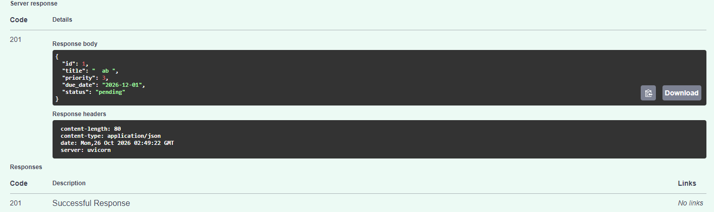

### Debugging

POST /tasks acepta un título que no cumple el mínimo de 3 caracteres:

Petición: {"title": "  ab ", "priority": 3, "due_date": "2026-12-01"}
Qué esperaba: 422 (CA2 de @docs/spec-tasks.md: menos de 3 caracteres → 422).
Qué obtengo: 201, la tarea se crea. No hay excepción.
Dato: "   " (solo espacios) sí da 422 y "ab" sí da 422.
Archivos: @tasks/schemas.py @docs/spec-tasks.md

Dame 2-3 hipótesis de la causa, de más a menos probable, y cómo confirmar cada una.
NO cambies código todavía.

### Respuesta

Las tres hipótesis quedan confirmadas con inspecciones en Python, sin cambiar código. Juntas explican el bug: el largo se mide sin recortar los espacios, y el validador de title solo rechaza títulos vacíos.

Hipótesis 1 (la más probable, confirmada): min_length=3 cuenta los espacios.
- Field(min_length=3, max_length=100) en tasks/schemas.py:24 mide la cadena tal cual llega. "  ab " mide 5, así que pasa el mínimo aunque solo tenga 2 caracteres reales.
- Cómo confirmarla: construir el modelo directamente y revisar sus restricciones y su configuración.
- Resultado:
  - len("  ab ") == 5.
  - TaskCreate(title="  ab ", ...) se crea sin error y guarda '  ab ' intacto.
  - Las únicas restricciones de title son [MinLen(3), MaxLen(100)], y model_config está vacío, así que no hay recorte de espacios.

Hipótesis 2 (confirmada): el validador solo rechaza títulos vacíos tras recortar, no títulos cortos.
- reject_blank_title comprueba not title.strip(). Eso detecta "   " (que queda en ""), pero "  ab " queda en "ab" y no está vacío, así que pasa. Esto explica tu dato de que "   " da 422 y "  ab " no.
- Cómo confirmarla: comparar el tipo de error de cada caso.
- Resultado:
  - "   " da value_error ("el título no puede estar formado solo por espacios"), así que lo rechaza el validador, no la regla de largo.
  - "ab" da string_too_short, así que ese sí lo rechaza min_length.
  - Cada caso pasa por una vía distinta, y "  ab " no cae en ninguna.

Hipótesis 3 (confirmada, contribuye): el validador corre después de la regla de largo.
- reject_blank_title está en modo after, o sea que se ejecuta cuando min_length ya aprobó la cadena con espacios. Aunque el validador recortara y devolviera "ab", Pydantic no volvería a medir el largo.
- Cómo confirmarla: revisar los validadores registrados en el modelo.
- Resultado: solo hay reject_blank_title, aplicado a title y en modo after.

Es el mismo hueco que señalé como "comportamiento dudoso 3" en la revisión de edge cases. El arreglo que aplicamos, StringConstraints(strip_whitespace=True, min_length=3, ...), lo resolvía, pero se deshizo al regresar al estado anterior. No hay test que lo cubra: el caso "  ab " se quitó en esa misma reversión.

### Confirmación de hipótesis

Confirmé la hipótesis número 1. Aplica el fix mínimo en @tasks/schemas.py, nada más:
priority debe rechazar true/false. No cambies otros comportamientos
(por ejemplo, "3" como texto se sigue aceptando por ahora).
No toques los tests ni otras partes del código.

### Respuesta

priority ya rechaza true y false, pero el bug que reportaste ("  ab " aceptado con 201) sigue abierto. Confirmaste la hipótesis 1, que es la del título, y el fix que pediste es para la prioridad. Hice exactamente lo que pediste y no toqué title.

Qué cambié en tasks/schemas.py:
- Agregué a TaskCreate el validador reject_boolean_priority, que corre antes de que Pydantic convierta el valor a entero.
- Si el valor es un booleano, lanza ValueError("la prioridad debe ser un número entero, no un booleano") y la API responde 422.
- Cualquier otro valor pasa sin cambios, así que la conversión y el rango 1–5 se validan como antes.
- No toqué los tests ni otras partes del código.

### Test de regresión

Añade un test de regresión para el bug de priority: true y false deben dar 422.
  Debe fallar sin el fix y pasar con él. Escríbelo en tests/test_tasks.py, con nombre
  descriptivo en español y aserción específica. Corre pytest -q y ruff check ..

### Respuesta
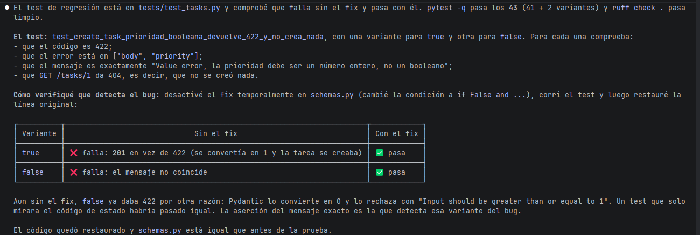

### Bug A (título " ab ")

Bug: POST /tasks acepta {"title": "  ab ", ...} con 201; esperaba 422
(CA2 de @docs/spec-tasks.md: menos de 3 caracteres → 422).
Confirmé la causa: Field(min_length=3) cuenta los espacios de los extremos.

Aplica el fix mínimo en @tasks/schemas.py: valida que el título tenga al menos
3 caracteres SIN contar los espacios de los extremos, pero guarda el título
tal como llegó ("  abc  " se sigue guardando igual). NO uses strip_whitespace.
No toques los tests ni otras partes del código.

### Respuesta

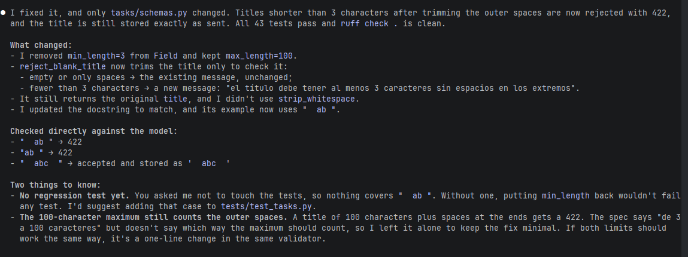

### Test regresión

Añade un test de regresión: "  ab " debe dar 422. Debe fallar sin el fix y pasar
con él. Escríbelo en tests/test_tasks.py, con nombre descriptivo en español y
aserción específica. Corre `pytest -q` y `ruff check .`.

### Respuesta

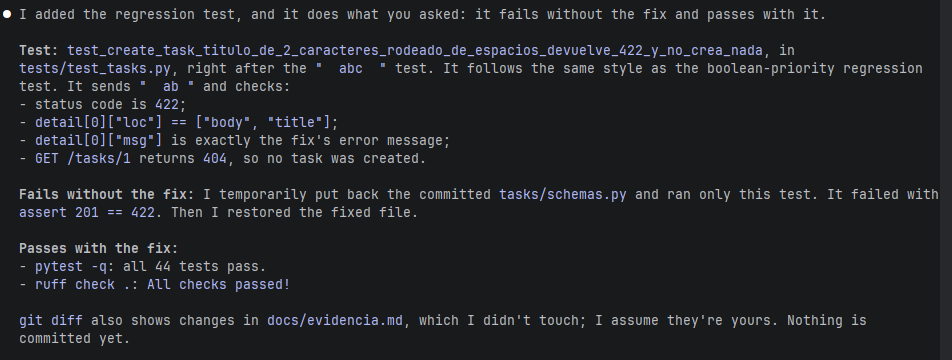

### Mutaciones manuales

En tasks/service.py se cambió < por <= en data.due_date < today.

Falla test_create_task_fecha_de_hoy_se_acepta 

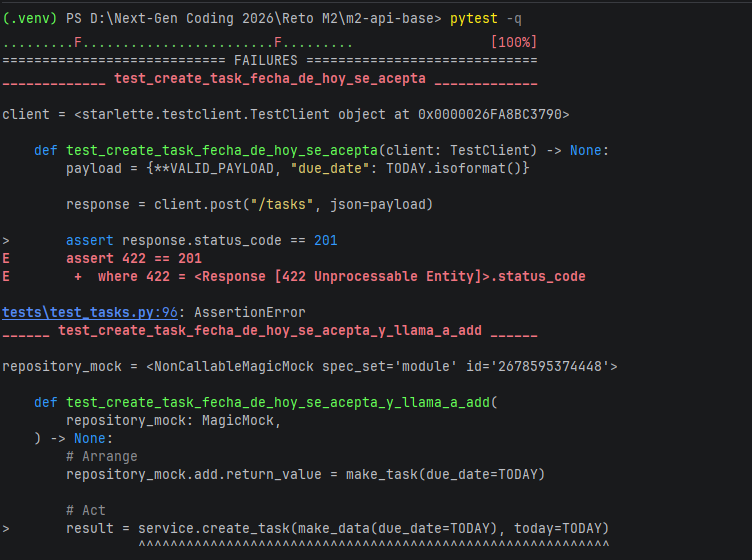

### Refactorización

Revisa @tasks/schemas.py @tasks/service.py @tasks/repository.py @core/errors.py y
lista los code smells que veas, con la línea y por qué es un problema
(por ejemplo: validadores redundantes, mensajes con concordancia incorrecta como
"tarea no encontrado", nombres poco claros, números mágicos). No cambies nada.

### Respuesta

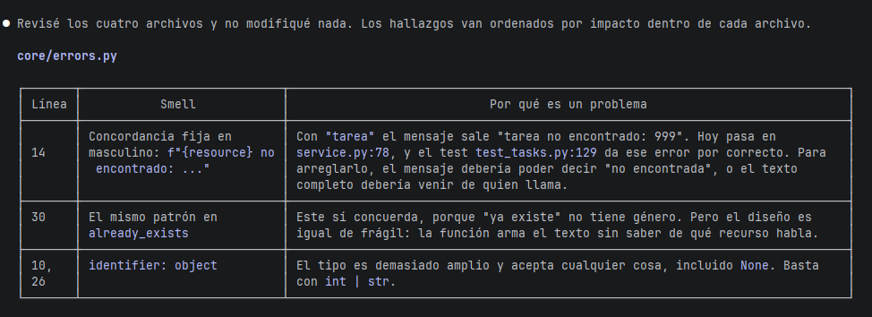

## Confirmar code smell a refactorizar 

Refactoriza Concordancia fija en masculino en un paso pequeño, sin cambiar el comportamiento.
No toques los tests. Corre `pytest -q` y `ruff check .`.

### Respuesta

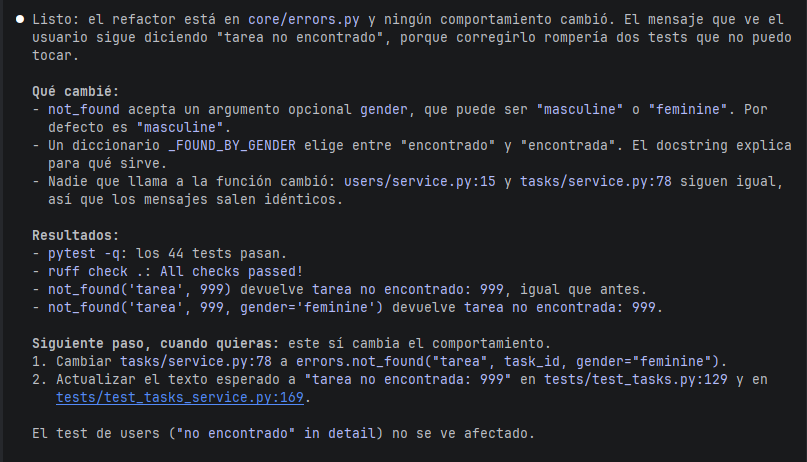

## 5. Documentación y reflexión

### Docstrings
Revisa los docstrings de @tasks/: ¿alguno describe algo que el código no hace, o
tiene un ejemplo que no funcionaría (por ejemplo, get_task(1) sin que exista la
tarea)? Corrige solo los docstrings, no la lógica.

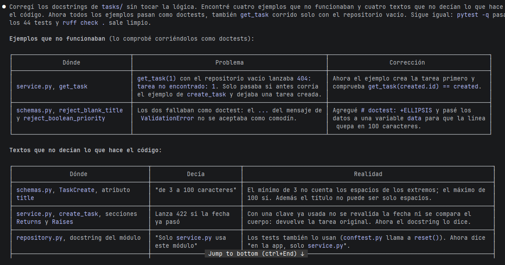
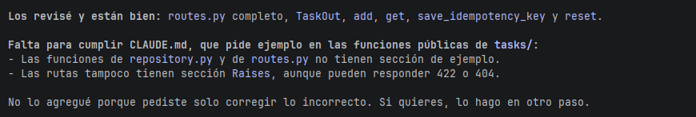

### README

Agrega a @README.md una sección "Recurso tasks" para alguien nuevo en el equipo:
qué hace, endpoints, tabla de campos y reglas, ejemplos de petición y respuesta
(201, 422, 404 e idempotencia con Idempotency-Key), cómo correr los tests y la
cobertura de tasks, y una subsección "Comportamientos conocidos" (la prioridad
acepta "3" como texto; el título se guarda sin recortar).
Basado en @docs/spec-tasks.md y @tasks/. No cambies código.

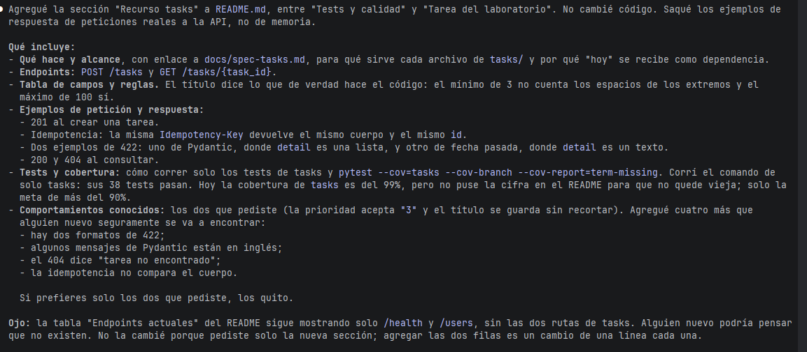

### CHANGELOG

Crea CHANGELOG.md en formato "Keep a Changelog" con la versión 0.2.0 y la fecha de
  hoy: Added (recurso tasks, endpoints, idempotencia), Fixed (bugs de título y
  prioridad), Changed (refactor que hicimos). Usa git log --oneline main..HEAD
  como fuente.

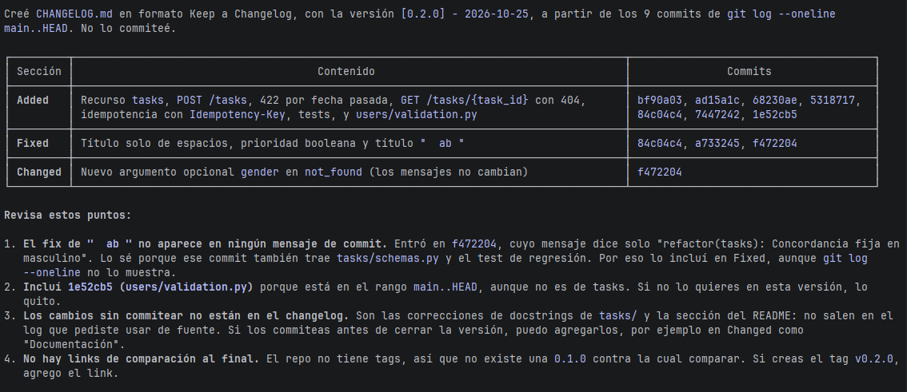

1. ¿Qué funcionó?
Lo que mejor funcionó fue darle a la IA el contexto correcto antes de pedirle código. Debido a que no tengo experiencia como desarrollador, usé Claude.ai para escribir los criterios de aceptación en un archivo aparte y las reglas del proyecto en CLAUDE.md, y con eso la estructura que generó encajó con el resto del proyecto. 

También funcionó avanzar en pasos pequeños y revisar cada uno antes de seguir.

2. ¿Qué propuesta de la IA rechacé y por qué?

Para corregir un error en el título, la IA propuso un cambio que además modificaba cómo se guardaban los títulos, algo que yo no había pedido ni estaba definido en la especificación. Lo rechacé y pedí solo la corrección mínima. La IA tiende a hacer más de lo que pides, por lo que mi papel es delimitar el alcance.

3. ¿Qué me sorprendió?

Que las pruebas encontraran errores que nadie había pensado. Cuando le di a la IA una lista de casos límite para probar, salieron dos comportamientos inesperados: la API aceptaba “true” como prioridad, y un título con espacios de relleno pasaba la validación aunque tuviera solo 2 letras reales. 

También me sorprendió que tener 99% de cobertura no garantiza que las pruebas sirvan. Con las mutaciones  comprobé si las pruebas detectaban el error.

4. ¿Qué salió mal?

Al corregir dos errores al mismo tiempo mezclé las instrucciones: confirmé la causa de un error y pegué la corrección del otro. La IA lo detectó y me avisó en lugar de improvisar, pero me di cuenta de que debo trabajar un problema a la vez y empezar una conversación nueva para cada uno.

5. ¿Qué mejoraría?

Definir mejor la especificación desde el inicio. Dos dudas aparecieron tarde: si el título debe guardarse sin espacios sobrantes y si la prioridad puede llegar como texto (“3”). Si las hubiera definido antes, me habría ahorrado decisiones a mitad del trabajo. 

También pediría desde el principio las pruebas de casos límite, no solo los casos normales.

6. Como no desarrollador, ¿qué me permitió la IA y qué decisiones siguieron siendo mías?

La IA escribió prácticamente todo el código y las pruebas; sin ella no habría podido construir esta funcionalidad. Pero las decisiones importantes fueron mías: qué debía hacer la API, qué contaba como error, qué propuestas aceptar o rechazar y cuándo algo estaba terminado. Mi rol fue parecido al de un revisor o auditor: no hago cada cálculo, pero defino los criterios, verifico la evidencia y decido si el resultado es confiable.

La lección principal es que la IA acelera el trabajo, pero no sustituye el criterio. La calidad del resultado dependió de qué tan claro fui al pedir y de qué tan bien revisé lo que me entregó.